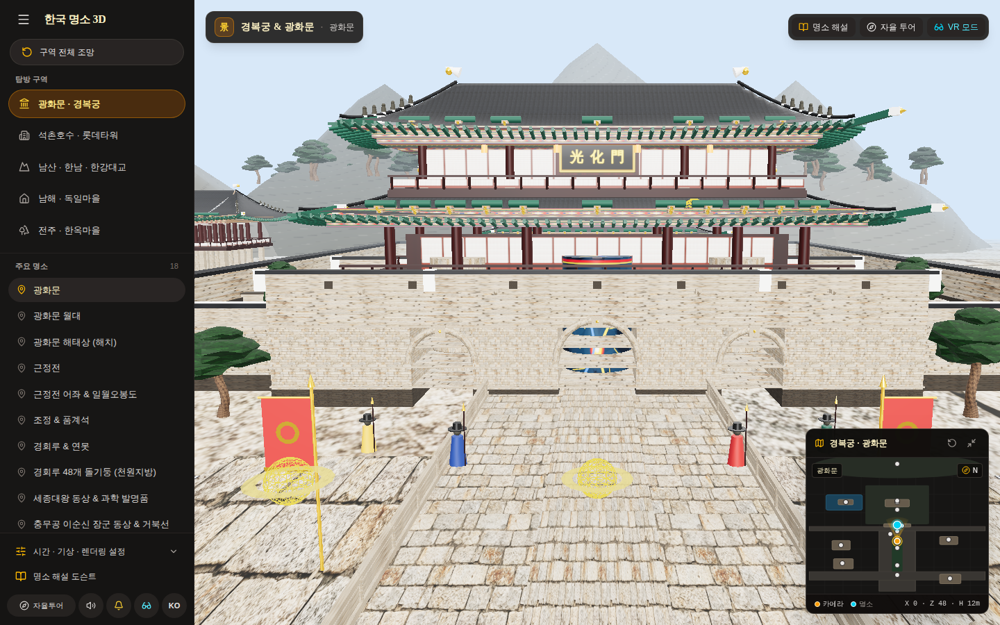
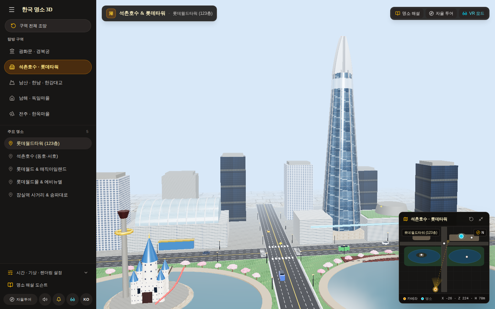
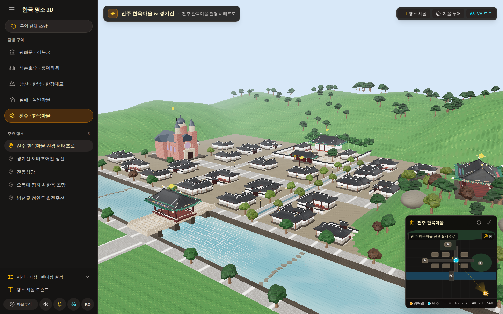

# Korea 3D Virtual Tour

Explore Korean palaces, cities, and villages in an interactive browser-based 3D tour. The buildings and landscapes are procedural interpretations of real places, not surveyed or dimensionally accurate models.

[한국어](README.md)

## Screenshots

### Gwanghwamun and Gyeongbokgung


### Seokchon Lake and Lotte World Tower


### Jeonju Hanok Village


## Features

- Five areas with landmark information: Gwanghwamun and Gyeongbokgung, Seokchon and Lotte, Namsan and the Han River, Namhae German Village, and Jeonju Hanok Village
- Procedural traditional architecture, including roofs, rafters and painted woodwork, alongside modern buildings
- 2D map, landmark camera navigation, auto-rotation and a Han River bridge drive
- Time of day, weather and rendering modes, ambient audio, and Korean/English UI
- WebXR and Cardboard VR modes on supported devices and browsers

## Getting started

Use Node.js 22.12 or later and a WebGL-capable browser.

```bash
npm install --legacy-peer-deps
npm run dev
```

Open `http://localhost:3000`. The `--legacy-peer-deps` flag avoids the current optional peer dependency conflict between Vite and esbuild. Normal touring does not require an API key or `.env` configuration. WebXR requires a supported device and a secure context (HTTPS or localhost).

Select an area and landmark in the sidebar. Drag to orbit, scroll to zoom, or use the map in the lower-right corner to move the camera.

## Development

```bash
npm run lint
npm run build
node --import tsx --test src/utils/*.test.ts src/three/models/architecturalCraft.test.ts
```

Built with React, TypeScript, Three.js and Vite. Scenes and architectural models are in `src/three`, landmark data in `src/data`, and UI components in `src/components`.
