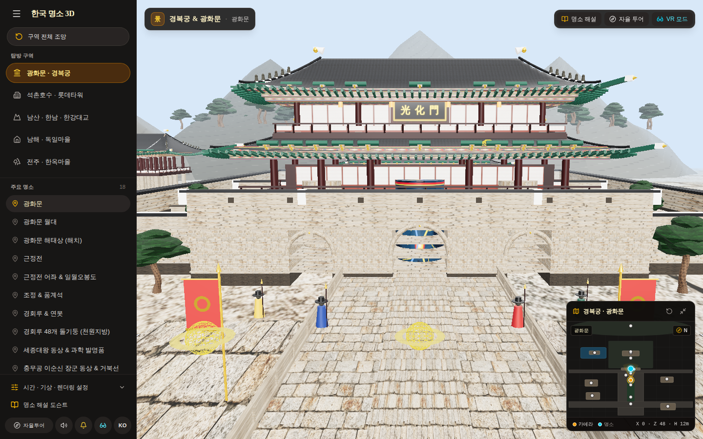
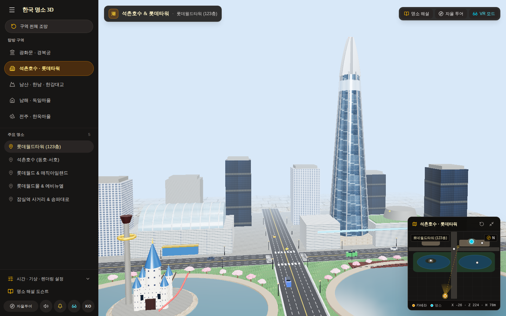
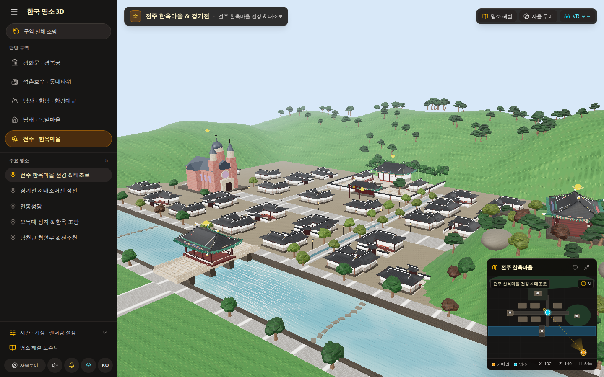

# 한국 명소 3D 가상 탐방

한국의 궁궐과 도시, 마을을 브라우저에서 둘러보는 인터랙티브 3D 투어입니다. 건축물과 풍경은 실제 장소를 바탕으로 절차적으로 제작한 모형이며, 정밀 실측 모델은 아닙니다.

[English](README.en.md)

## 주요 화면

### 광화문 · 경복궁


### 석촌호수 · 롯데타워


### 전주 · 한옥마을


## 기능

- 광화문·경복궁, 석촌호수·롯데타워, 남산·한강, 남해 독일마을, 전주 한옥마을의 다섯 구역과 명소 해설
- 지붕, 서까래, 단청 등 전통 건축 요소와 현대 건축물의 절차적 3D 모델링
- 2D 지도와 명소별 카메라 이동, 자동 회전, 한강대교 주행
- 시간대·날씨·렌더링 모드 변경, 배경음, 한국어·영어 UI
- WebXR 및 카드보드 VR 모드 (기기와 브라우저 지원 필요)

## 시작하기

Node.js 22.12 이상과 WebGL을 지원하는 브라우저가 필요합니다.

```bash
npm install --legacy-peer-deps
npm run dev
```

브라우저에서 `http://localhost:3000`을 엽니다. `--legacy-peer-deps`는 현재 Vite와 esbuild의 선택적 피어 의존성 충돌을 피하기 위해 필요합니다. 일반 탐방에는 API 키나 `.env` 설정이 필요하지 않습니다. WebXR은 지원 기기와 보안 컨텍스트(HTTPS 또는 localhost)가 필요합니다.

왼쪽 메뉴에서 구역과 명소를 선택하고, 드래그하여 시점을 회전하거나 스크롤하여 확대·축소합니다. 오른쪽 아래 지도에서도 시점을 이동할 수 있습니다.

## 개발

```bash
npm run lint
npm run build
node --import tsx --test src/utils/*.test.ts src/three/models/architecturalCraft.test.ts
```

React, TypeScript, Three.js, Vite를 사용합니다. 장면과 건축 모델은 `src/three`, 명소 데이터는 `src/data`, UI는 `src/components`에 있습니다.
